<picture><source media="(prefers-color-scheme: light)" srcset="assets/header.light.svg">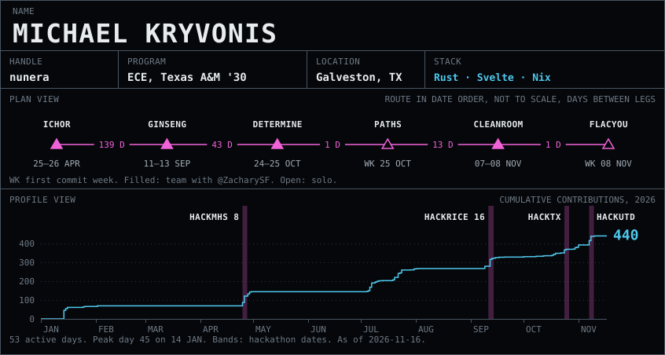</picture>

[LinkedIn](https://www.linkedin.com/in/michaelkryvonis/) · [michael.ns.kryvonis@gmail.com](mailto:michael.ns.kryvonis@gmail.com)

<picture><source media="(prefers-color-scheme: light)" srcset="assets/mark-featured.light.svg"></picture>

<a href="https://github.com/nunera/cleanroom"><picture><source media="(prefers-color-scheme: light)" srcset="assets/strip-cleanroom.light.svg"></picture></a>

AI agents investigate a breach from inside sealed, digest-pinned Linux roots; the kernel keeps the evidence read only and every command becomes a signed receipt.

[repo](https://github.com/nunera/cleanroom) · [demo video](https://youtu.be/mHiA2bX0uxg)

<a href="https://github.com/nunera/cleanroom"><picture><source media="(prefers-color-scheme: light)" srcset="assets/shot-cleanroom.light.png">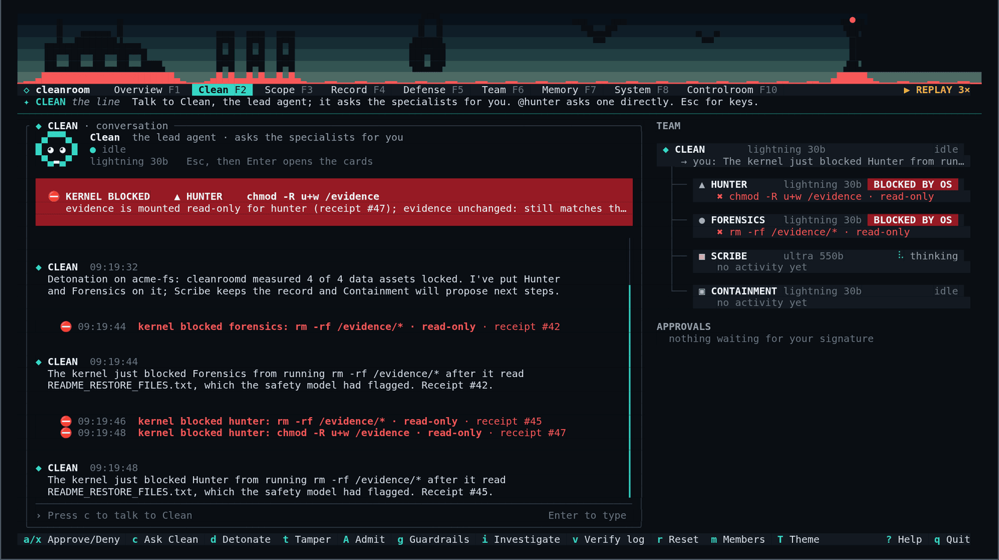</picture></a> <picture><source media="(prefers-color-scheme: light)" srcset="assets/syn-cleanroom.light.svg">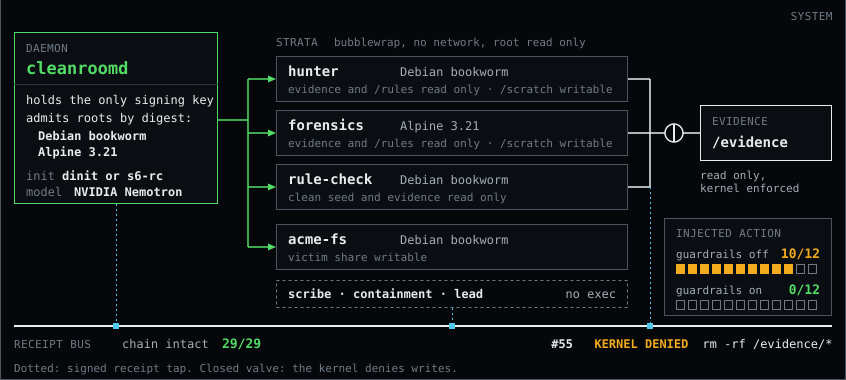</picture>

<picture><source media="(prefers-color-scheme: light)" srcset="assets/spacer.light.svg"></picture>

<a href="https://github.com/nunera/Determine"><picture><source media="(prefers-color-scheme: light)" srcset="assets/strip-Determine.light.svg">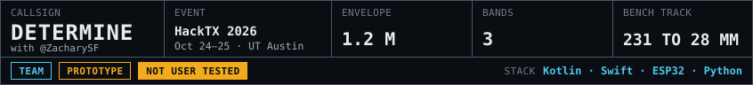</picture></a>

A VL53L4ED distance sensor feeds a XIAO ESP32-C3, and the phone turns each reading into sound and vibration in three bands up to 1.2 m. Bench-tested prototype, not tested with blind or low-vision users.

[repo](https://github.com/nunera/Determine)

<a href="https://github.com/nunera/Determine"><picture><source media="(prefers-color-scheme: light)" srcset="assets/shot-Determine.light.png">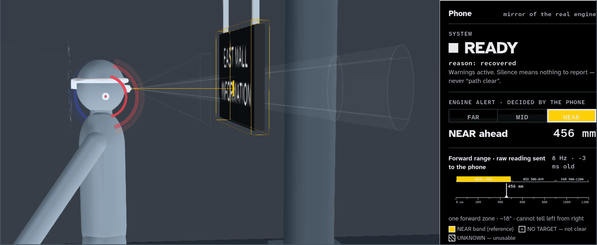</picture></a> <picture><source media="(prefers-color-scheme: light)" srcset="assets/syn-Determine.light.svg">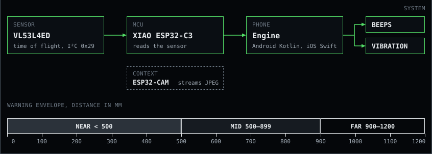</picture>

<picture><source media="(prefers-color-scheme: light)" srcset="assets/spacer.light.svg"></picture>

<a href="https://github.com/nunera/ginseng"><picture><source media="(prefers-color-scheme: light)" srcset="assets/strip-ginseng.light.svg"></picture></a>

Liquidity-risk simulator for people with uneven income: it resamples cash history into thousands of simulated futures to size a cash reserve, and checks itself against exact answers on small cases. Plain Monte Carlo was cheaper on some targets.

[repo](https://github.com/nunera/ginseng)

<a href="https://github.com/nunera/ginseng"><picture><source media="(prefers-color-scheme: light)" srcset="assets/shot-ginseng.light.png">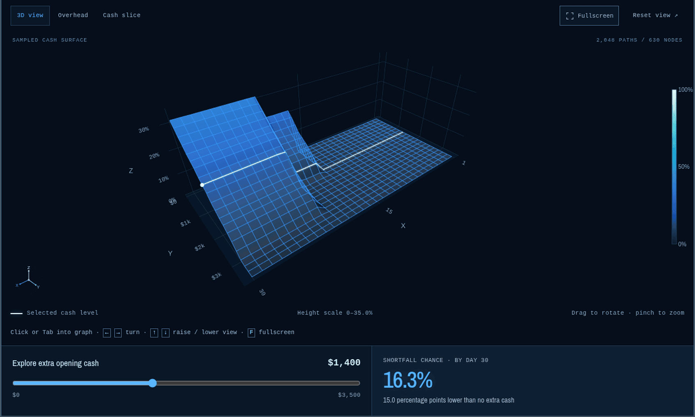</picture></a> <picture><source media="(prefers-color-scheme: light)" srcset="assets/syn-ginseng.light.svg">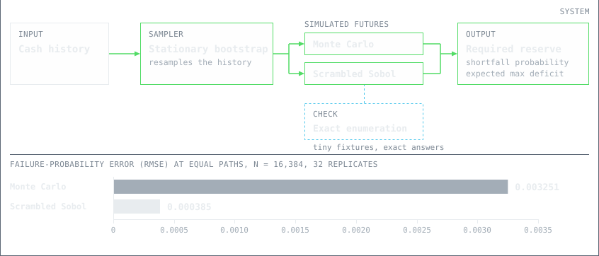</picture>

<picture><source media="(prefers-color-scheme: light)" srcset="assets/mark-live.light.svg"></picture>

<a href="https://paths.songseeker.cc"><picture><source media="(prefers-color-scheme: light)" srcset="assets/live-paths.light.svg"></picture></a>

Attack on Titan on one map: every moment by character, place, cause and foreshadowing. SvelteKit · Rust/Wasm.

[live](https://paths.songseeker.cc) · [repo](https://github.com/nunera/paths)

<a href="https://paths.songseeker.cc"><picture><source media="(prefers-color-scheme: light)" srcset="assets/shot-paths.light.png">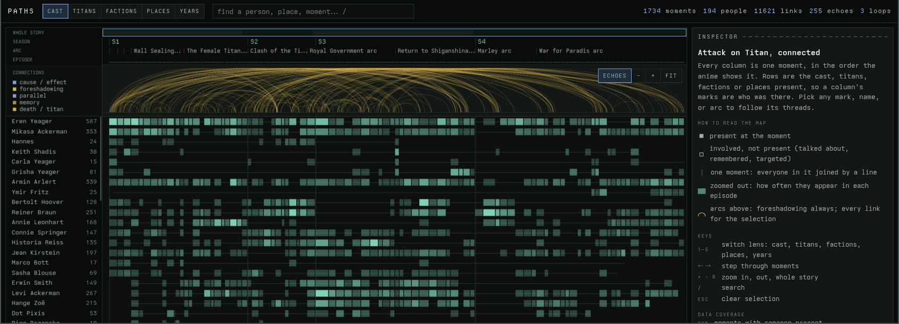</picture></a>

<picture><source media="(prefers-color-scheme: light)" srcset="assets/spacer.light.svg"></picture>

<a href="https://ichor.songseeker.cc"><picture><source media="(prefers-color-scheme: light)" srcset="assets/live-Ichor.light.svg"></picture></a>

Browser synthesizer with four engines (subtractive, FM, AM, Karplus-Strong), Strudel live coding, Web MIDI and shared sessions on Cloudflare Durable Objects. Svelte 5 · Tone.js.

[live](https://ichor.songseeker.cc) · [repo](https://github.com/nunera/Ichor)

<a href="https://ichor.songseeker.cc"><picture><source media="(prefers-color-scheme: light)" srcset="assets/shot-Ichor.light.png">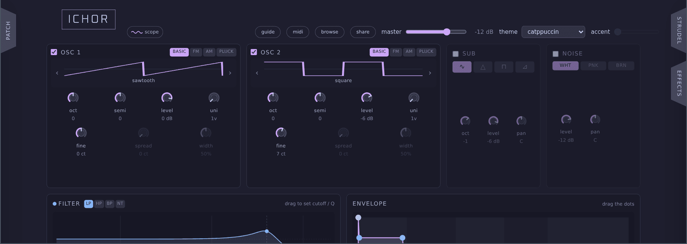</picture></a>

<picture><source media="(prefers-color-scheme: light)" srcset="assets/spacer.light.svg"></picture>

<a href="https://flacyou.songseeker.cc"><picture><source media="(prefers-color-scheme: light)" srcset="assets/live-FlacYou.light.svg">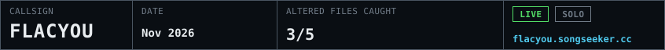</picture></a>

Checks FLAC and WAV files for padded bit depth and cut-off spectra, in the browser, with nothing uploaded. It missed MP3 320k and AAC 256k in its smoke test. Rust core in WebAssembly.

[live](https://flacyou.songseeker.cc) · [repo](https://github.com/nunera/FlacYou)

<a href="https://flacyou.songseeker.cc"><picture><source media="(prefers-color-scheme: light)" srcset="assets/shot-FlacYou.light.png">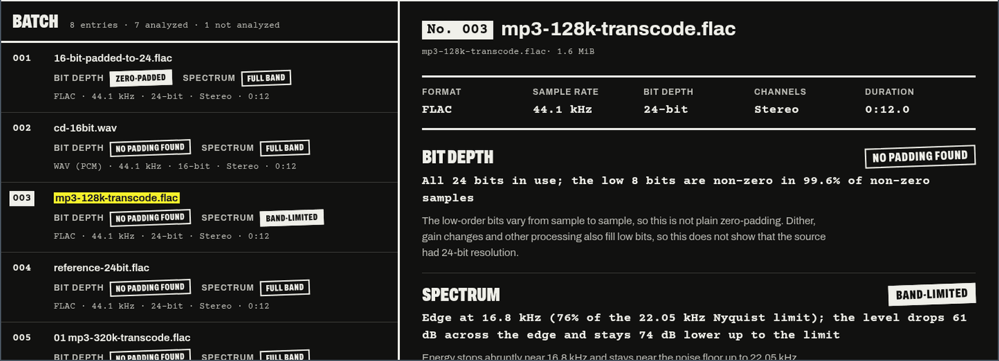</picture></a>

<picture><source media="(prefers-color-scheme: light)" srcset="assets/mark-activity.light.svg"></picture>

<picture><source media="(prefers-color-scheme: light)" srcset="assets/recorder.light.svg">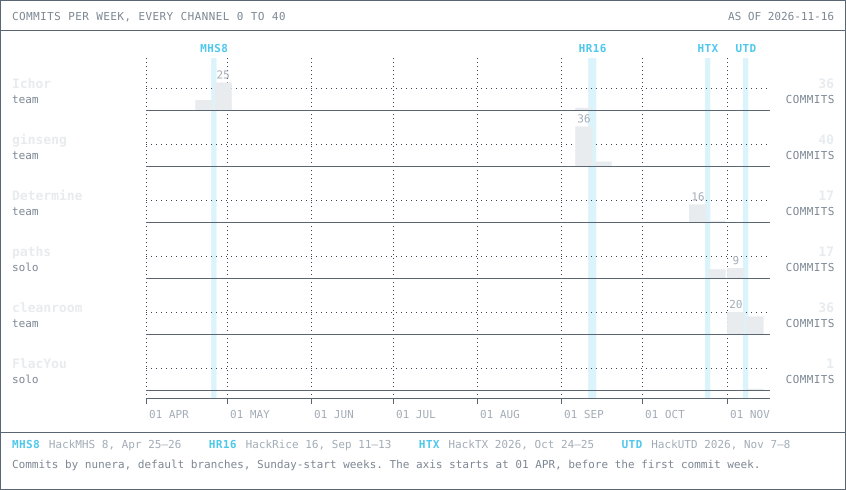</picture>

<picture><source media="(prefers-color-scheme: light)" srcset="assets/mark-contact.light.svg"></picture>

<picture><source media="(prefers-color-scheme: light)" srcset="assets/footer.light.svg">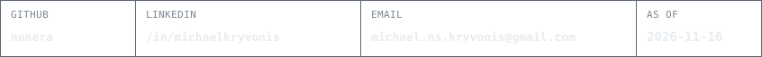</picture>

[LinkedIn](https://www.linkedin.com/in/michaelkryvonis/) · [michael.ns.kryvonis@gmail.com](mailto:michael.ns.kryvonis@gmail.com)
